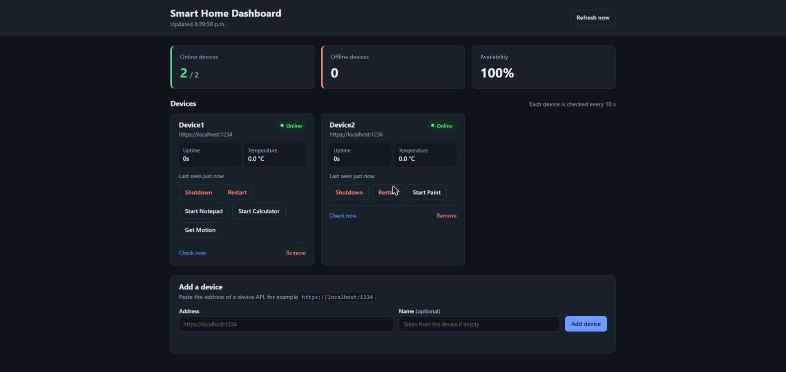

# Smart Home Management

Backend for a smart home management system, built with .NET 11 for the DataArt IT Camp
".NET Smart Home" workshop. It connects to virtual smart devices, stores them in a database,
lets you send them commands through a Web API, and shows a **device monitoring dashboard**
with the status of every device and the number of devices online.



## What's inside

| Project | What it does |
| --- | --- |
| `src/HomeManagementDeviceApi` | The virtual smart device emulator provided by the workshop ([original repository](https://github.com/VladislavAntonyuk/HomeManagementDeviceApi)). Each running instance is one device. |
| `src/HomeManagement.Api` | The home management system: Minimal API + SQLite database + background monitor + dashboard. |

### Features

- **Device registry** stored in SQLite (Entity Framework Core). The database file is created automatically.
- **Health monitoring**: a background service checks every device every 10 seconds and records
  whether it is online, when it was last seen and its latest metrics (uptime, temperature).
- **Commands**: run any action a device exposes in its `/config` (start an app, restart, …).
  Only the device's own actions can be run; the caller can't send arbitrary commands.
- **Dashboard** at `/`: online / offline / total counters, availability, one card per device with
  status, metrics, last seen time and action buttons. It refreshes itself every 5 seconds.

## Requirements

- [.NET 11 SDK](https://dotnet.microsoft.com/download)
- A trusted ASP.NET Core development certificate (once per machine):

  ```
  dotnet dev-certs https --trust
  ```

## Run it

Open three terminals in the repository folder.

1. Start the two virtual devices:

   ```
   dotnet run --project src/HomeManagementDeviceApi --launch-profile Device1
   dotnet run --project src/HomeManagementDeviceApi --launch-profile Device2
   ```

2. Start the home management API:

   ```
   dotnet run --project src/HomeManagement.Api
   ```

3. Open **http://localhost:5150**.

On first run both devices (`https://localhost:1234` and `https://localhost:1236`) are registered
automatically. Stop one of the devices (Ctrl+C) and within 10 seconds it turns red and the
"Online devices" counter goes down; start it again and it comes back.

> On Windows the emulator reports `0` for uptime and temperature, because it reads those values
> from Linux system files. On Linux it shows real values.

## Web API

| Method | Route | Description |
| --- | --- | --- |
| `GET` | `/api/dashboard` | Summary for the dashboard: total, online, offline and every device. |
| `GET` | `/api/devices` | List registered devices. |
| `GET` | `/api/devices/{id}` | One device. |
| `POST` | `/api/devices` | Register a device. Body: `{ "address": "https://localhost:1234", "name": "optional" }` |
| `DELETE` | `/api/devices/{id}` | Remove a device. |
| `POST` | `/api/devices/{id}/refresh` | Check the device now instead of waiting for the monitor. |
| `GET` | `/api/devices/{id}/info` | Live information read straight from the device. |
| `POST` | `/api/devices/{id}/actions/{action}` | Run a device action, e.g. `/api/devices/1/actions/Start%20Notepad`. |

Errors are returned as standard `application/problem+json`
(`400` invalid address, `404` unknown device or action, `409` duplicate address,
`502` the device did not answer).

## Configuration

`src/HomeManagement.Api/appsettings.json`:

| Setting | Default | Meaning |
| --- | --- | --- |
| `ConnectionStrings:Home` | `Data Source=smarthome.db` | SQLite database file. |
| `Monitoring:IntervalSeconds` | `10` | How often every device is checked. |
| `Devices:Seed` | the two emulators | Devices registered when the database is empty. |
| `Devices:AcceptLocalhostDevCertificate` | `true` (Development only) | Accept the local development certificate for `localhost` devices even if it is not trusted. |

## Project structure

```
src/HomeManagement.Api
├── Program.cs                     # wiring: database, HttpClient, monitor, endpoints
├── Data/                          # Device entity, DbContext, database creation + seed
├── Devices/                       # DeviceClient (HttpClient), status checks, device endpoints
├── Monitoring/DeviceMonitor.cs    # background service that checks devices periodically
├── Dashboard/                     # /api/dashboard endpoint
└── wwwroot/                       # dashboard page (HTML, CSS, JavaScript)
```

## Security note

This is a local development project. The API has no authentication and the device emulator can
start programs on the machine it runs on, so don't expose either of them to the internet.
